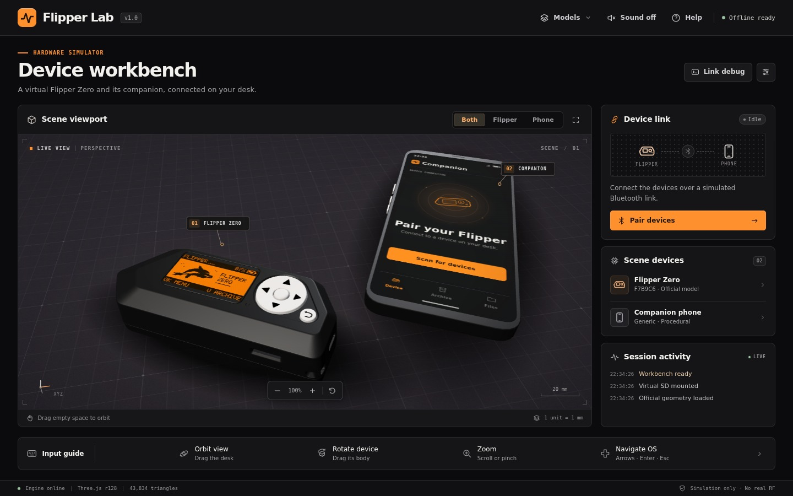

# Flipper Lab · Device workbench

**Open `index.html`.** A Flipper Zero and a companion phone sit on a millimetre-scale 3D desk. Press the Flipper’s white buttons, tap the phone, and pair them to share one virtual SD card. The official **F7B9C6** body, Three.js r128, both simulated operating interfaces and all assets ship in this repository.

**Unofficial fan project. Radio operations are simulated; no real RF.** Not affiliated with Flipper Devices. No accounts, telemetry, real Bluetooth, NFC, USB, credential handling, executable payloads or firmware.



## Run it

- **Desktop:** clone or unzip the whole folder, then open `index.html` in a modern browser with WebGL enabled. `file://` works without a server, install, build, cache-warming visit or internet connection. Do not move the HTML away from its sibling directories.
- **iPhone / iPad:** the supported delivery method is a static server on your own LAN. On a computer in the folder, run `python3 -m http.server 8000 --bind 0.0.0.0`. On the same Wi-Fi, open `http://<computer-LAN-IP>:8000/` in Safari. This serves the same local files; no internet or backend is involved. Opening a local HTML file through the iOS Files preview is best-effort, not the recommended path.
- WebGL failure produces a full-screen explanation. Reduced-motion preferences disable idle breathing, automatic camera animation, moving packets and Find My shaking/flashing. Sound starts off on a new card; WebAudio is unlocked by a gesture.

### Try the complete loop

1. On the phone tap **Scan for devices → Flipper Zero**. Check the six-digit PIN on both displays. Tap **Confirm pairing** on the phone or press **OK** on the Flipper. The inspector’s **Pair devices** button offers the same flow. A thin animated beam appears only while connected.
2. On the phone open **Archive → subghz**. On the Flipper press **OK → Sub-GHz → Scan spectrum**. When the result appears, press **OK** to save it. It appears on the phone without reloading.
3. Tap **···** beside the file on the phone to rename or delete it. From the Flipper home screen, **Down** opens Archive; it reads the same card. **Right → Device name** changes the name on both devices.
4. The phone’s **Device** tab shows battery, firmware and used card space from RPC. Try **Find my Flipper**, or **Firmware update → Install local update** to watch checking, downloading, uploading and rebooting. None of these steps transfers firmware.

## Controls

| Input | Action |
|---|---|
| Drag empty desk | Orbit the camera |
| Drag device body | Lift and freely rotate; release to settle back |
| Wheel / two-finger pinch / − and + | Zoom |
| Double-click / double-tap the desk, or reset-camera button | Restore the current view |
| Both / Flipper / Phone, or a Scene devices row | Dolly to a fitted view; neither model is switched off |
| White D-pad, OK, Back, or arrows / Enter / Esc | Drive the 128×64 monochrome LCD shell |
| Home: OK / Down / Right / Left | Main menu / Archive / Settings / Apps |
| File manager: Up/Down, OK, Right, Back | Select, open, actions, return |
| Name editor | Type a replacement name, or Left/Right for cursor and Up/Down for character; OK saves, Back cancels |
| Phone display | Tap controls or drag a list/preview to scroll; a 6 CSS-pixel threshold separates taps from drags |
| Phone side rail | Long white power clicker sleeps/wakes; two shorter clickers change synthesized volume |

**Models** switches the official body between normal and colour-coded part inspection, and the procedural phone between two sizes, without disconnecting. The viewport expand button gives either screen more space. On narrow screens devices are framed vertically; **Device link** beneath the viewport opens the inspector. **Help**, **Sound**, **Link debug** and the **Session storage** sliders icon are independent of the on-device menus.

### Calibration

Append `?calibrate` to the page address. Adjust the screen quad’s XYZ position, dimensions and rotation, or each button anchor, axis and travel. Edits apply live and autosave locally. Use **LCD alignment pattern** and **Models → Official body · part inspection** to inspect the window and sectors. **Copy manifest** falls back to selectable JSON if clipboard access is unavailable. **Factory values** restores measured defaults. See [model provenance and measurements](models/SOURCES.md).

## What runs on the devices

The main menu follows the reference emulator’s built-in order: **Sub-GHz, 125 kHz RFID, NFC, Infrared, GPIO, iButton, Bad USB, U2F, Apps, Settings**. The font, dolphin’s three animation states, remote faces and phone graphics are drawn locally, not copied from firmware.

| Tool | Simulated operation | Virtual SD directory |
|---|---|---|
| Sub-GHz | Sweep an invented spectrum; save a randomized named reading | `/ext/subghz` |
| 125 kHz RFID / NFC | Scan a three-tag inventory, choose a token, save its record | `/ext/lfrfid`, `/ext/nfc` |
| Infrared | Choose an imaginary brand’s remote, tap controls, save its state with Down | `/ext/infrared` |
| GPIO | Left/Right select a pin, OK toggles it, Down saves the eight-pin bank | `/ext/gpio` |
| iButton | Read the virtual contact slot; Right writes a new synthetic token, OK saves a reading | `/ext/ibutton` |
| Bad USB | Play inert text lines on the LCD; OK advances or saves the completed log | `/ext/badusb` |
| U2F | Acknowledge an invented challenge, save its pretend response | `/ext/u2f` |

Apps includes **Clock** (12/24 h), **Hex viewer** (UTF-8 bytes from actual virtual files), **Music player** (original synthesized notes and animated bars), Archive, file manager, LCD screenshot capture and storage information. There is **no `.fap` execution**. Settings includes device name, brightness, sound and firmware/about information.

## Storage and link

- Device settings live in `flipper-os.js`; the card’s only tree lives in `flipper-fs.js`. The phone never reads either directly. Its lists and dashboard are response snapshots, refreshed by change events.
- The link transports `{id, type, cmd, payload, error}` with **30–120 ms per message**, including the response leg. Commands include `system.info/ping/rename`, `storage.list/read/rename/delete/info`, `app.find`, `firmware.update.start/progress` and `link.status`. Discovery/PIN control messages are separate. Storage and device RPCs are gated by the current connection generation. Debug includes round-trip timing, packet log and 0/10/30% loss; dropped requests time out.
- Signal bars use the 3D distance between display anchors, not camera zoom. Pairing is session-only. Files, preferences and calibration use `fz.v1.*` keys behind guarded storage with an in-memory fallback. Browser quotas and `file://` storage rules vary.
- **Session storage → Export JSON** backs up the SD tree, device settings and audio preferences. Import validates the version, tree, filenames, depth, node count and content size before asking to replace data. Model/camera selections and calibration are local workspace preferences, not part of the SD backup. **Reset storage** asks first, removes only `fz.v1.*` keys and restores the small demo card. Export before moving the folder or changing browser/origin.

## Repository map

```
index.html, css/style.css      Classic-script entry and responsive workbench
js/core.js, audio.js          FZ namespace, storage, events, synthesized audio
js/screen.js, scene.js        Dirty canvas textures, camera, picking and animation
js/models.js                  Indexed official mesh / procedural phone builders
js/flipper-{os,fs,tools,apps}.js  LCD shell, virtual SD, instruments and mini-apps
js/phone-app.js, link.js      Companion client and in-page RPC channel
js/ui.js, icons.js            Inspector, controls, calibration, backups and glyphs
js/self-test.js               Asynchronous, cleanup-safe integration smoke test
models/library.js             Registry (window.FZ_MODELS)
models/manifest.js            Validated calibration overlays
models/flipper-model.js       Generated positions, indices, parts and defaults
models/source/                Original official STL, drawing and upstream LICENSE
vendor/, LICENSES/            Pinned Three.js UMD and license texts
DEPENDENCIES.md                Source URLs, versions, SHA-256s
models/SOURCES.md             Geometry provenance, part counts and alignment
tools/                        Conversion, vendoring and optional verification
docs/verification/            Actual browser screenshots, not runtime assets
```

All app scripts are classic IIFEs. There are no ES modules, runtime model loaders, asset fetches, CDNs, remote fonts or audio files. The page’s CSP disables connections. Screens use emissive canvas textures: logical LCD pixels are enlarged with nearest filtering; power-of-two backing textures support clean minification. Only dirty textures upload, at **≤30 fps**. Cached vectors/quaternions service animation. WebGL draws on change or while animating; the next visible screen deadline wakes an otherwise idle scene. Pixel ratio is capped at 2 desktop / 1.5 mobile. Contact shadows and warm pools are procedural gradients; there are no shadow maps or environment files.

## Verification

**Browser run:** Chromium 141.0.7390.0, opened via `file://`, network emulation offline, no file-access or web-security bypass. **23 grouped checks passed, zero console/page errors, zero network requests.** The 20 local file loads include the HTML itself. Built-in `await FZ.selfTest()` returned **10 PASS / 0 FAIL** from a disconnected session. It performs a real pair/RPC/read/write/delete/rename cycle with a scratch file and restores the prior name and link state; run it outside an update or pairing dialog.

- Sample timings including UI input: **2.26 s** to pair, **331 ms** for a saved Sub-GHz capture to reach Archive, **283 ms** for a Settings rename to reach the phone. Phone deletion removed the entry from the open Flipper file manager.
- Verified all six physical Flipper controls and their motion, phone power/volume, mouse orbit/lift/return, wheel zoom, double-click reset, touch pinch/tap/double-tap, UV drag-scroll, model switching, calibration persistence, JSON export/import, scoped reset, blocked-storage fallback, reduced motion and the WebGL failure screen.
- **43,834 rendered triangles** in the standard two-device scene, **43,852** with the beam/packets. An unchanged menu with reduced motion rendered **zero extra frames** over the idle sample. An active-beam sample in the sandbox’s **software** renderer was **15 fps**, not a hardware benchmark. The 45+ fps target on an integrated GPU and physical iOS Safari performance are **not verified**.
- Evidence: [desk](docs/verification/desk.jpg), [paired desk](docs/verification/connected.jpg), [colour-coded facets and L/R LCD pattern](docs/verification/parts-and-lcd.jpg), [LCD canvas](docs/verification/flipper-lcd.png), [phone canvas](docs/verification/phone-dashboard.png), [touch viewport](docs/verification/mobile.jpg).

**Re-run without installing anything in this repo:**

```sh
python3 tools/convert-model.py     # regenerate from the committed official STL
python3 tools/verify-offline.py    # Python 3.9+ and Node: hashes, all facets,
                                   # deterministic conversion, GLB/ASCII fixtures,
                                   # all JS syntax, URLs and asset paths
```

The optional browser harness requires Chromium and Puppeteer **only for QA**. For example, on a system with Chrome installed:

```sh
qa=$(mktemp -d)
npm install --prefix "$qa" puppeteer-core@24.25.0
NODE_PATH="$qa/node_modules" CHROME_BIN=/path/to/chrome \
  node tools/verify-browser.cjs . "$qa/screenshots"
```

The harness uses a temporary browser profile and does not touch your own session. For a headless software GPU use `FZ_SOFTWARE_GL=1`; `FZ_NO_SANDBOX=1` is only for already isolated test containers. This run used the Chromium binary and SwiftShader from `@sparticuz/chromium@141.0.0`, outside the checkout. None of these packages is needed by the application.

## Assumptions and limits

- This is a **behavioral re-implementation**, not a firmware emulator. The [reference main-menu registry](https://github.com/ZDStudios/Flipper-Zero-Emulator/blob/23edb1bf355698cc0d9c37f297c2102ecd1b114f/pyflipper/core/registry.py) and [Android companion components](https://github.com/flipperdevices/Flipper-Android-App/tree/bc6d8151d99e84947423b1cf55bc93fc5498f60f/components) informed the flows. No code, bitmap font, app icon, protocol or firmware from either was vendored.
- Confirming the matching PIN on **either** screen completes the local handshake. The inspector mirrors the same controls for small screens. The beam visualizes an established local connection, not real transmissions.
- Battery is a fixed simulated 87%; card capacity is a nominal 128 MB, not a reserved allocation. Firmware advances between two local version strings. Remotes, keys and challenges have no compatibility with real devices. Bad USB is a **read-only text animation** with no HID interpreter or output.
- The official body is not remodelled or decimated. Its 37 × 22 mm moulded recess surrounds a 2:1 active display and unlit bezel; the upstream model intentionally omits internals. The phone is original and procedural; the optional external CC0 phone was skipped. Static embedded GLB input is supported by the *offline converter*, not a general-purpose runtime GLTF loader.
- Mouse/touch verification used real browser input events and Chromium touch emulation, not a physical iPhone, Bluetooth connection or integrated-GPU laptop.

## Licenses

- **Official STL, drawing, and derived `models/flipper-model.js`: GPL-3.0.** The generated mesh remains GPL-3.0. See [upstream source credit](models/SOURCES.md) and [full license](LICENSES/GPL-3.0.txt).
- **Three.js r128: MIT**, [original license](LICENSES/MIT.txt). See [dependency hashes and the reproducible vendoring script](DEPENDENCIES.md).
- **Original application, procedural phone, sprites, icons and tools: MIT**, continuing this repository’s original licensing; see [project license](LICENSES/PROJECT-MIT.txt). The upstream model’s license is separate. Flipper Zero is a Flipper Devices product; this project is not endorsed by them.
